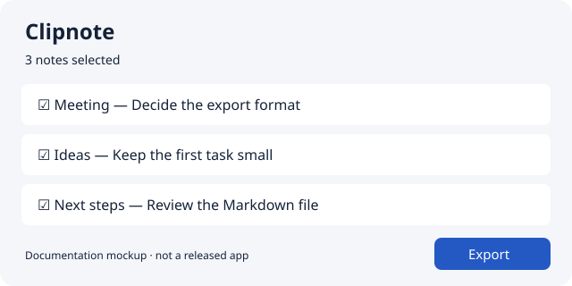

# Clipnote

> 가상 프로젝트의 문서 예시입니다. 제품·설치 파일·실행 검증을 제공하지 않습니다.

짧은 메모를 모아 선택한 항목을 Markdown으로 내보내는 앱입니다.

[English](README.md) | [한국어](README.ko.md)

<picture>
  <source media="(prefers-color-scheme: dark)" srcset="assets/notes-dark.svg">
  <source media="(prefers-color-scheme: light)" srcset="assets/notes-light.svg">
  
</picture>

*출시된 앱의 스크린샷이 아닌 문서용 목업입니다.*

## 설치와 첫 내보내기

예시 설계의 대상은 macOS 14 이상입니다. 실제 프로젝트에서는 릴리스 페이지의 서명된 앱을 내려받아 Applications로 옮깁니다. 이 예시에는 다운로드할 빌드가 없습니다.

1. Clipnote를 열고 Meeting이라는 메모를 만듭니다.
2. 짧은 문단을 입력한 뒤 메모를 선택합니다.
3. **Export**를 누르고 저장 폴더를 선택합니다.
4. 해당 폴더의 `Meeting.md`를 열어 내용을 확인합니다.

## 저장과 제한

이 설계에서 메모는 앱의 로컬 데이터 폴더에 남고 내보낸 파일은 선택한 폴더에 저장됩니다. 동기화와 공동 편집은 없습니다. 앱 삭제는 메모와 내보낸 파일을 삭제하지 않습니다. 앱 데이터를 지우기 전에 필요한 내용을 내보냅니다.

## 도움받기

[내보내기 문제 해결 — 영어](docs/troubleshooting.md)를 참고합니다. 문제를 보고할 때 앱·OS 버전과 실패한 단계를 적고 개인 메모는 첨부하지 않습니다.

기여자용 개발 환경

이 목업에는 구현이 없습니다. 실제 프로젝트에서는 검증한 빌드·테스트 방법을 기여 문서에 작성하고 사용자 설치와 분리해 연결합니다.

## 라이선스

가상 제품의 별도 배포 라이선스는 없습니다. 이 문서 예시 자체에는 저장소의 [MIT 라이선스](../../LICENSE)가 적용됩니다.
