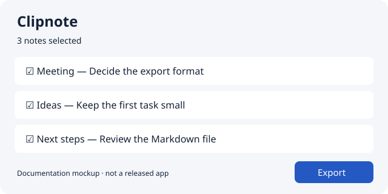

# Clipnote

> Fictional documentation example. This project is not distributed; commands, APIs, versions, and results below describe an illustrative design, not a tested product. URLs under `example.invalid` are intentionally non-installable.

Collect short notes and export a selected set as Markdown.

[English](README.md) | [한국어](README.ko.md)

<picture>
  <source media="(prefers-color-scheme: dark)" srcset="assets/notes-dark.svg">
  <source media="(prefers-color-scheme: light)" srcset="assets/notes-light.svg">
  
</picture>

*Documentation mockup, not a screenshot of a released app.*

## Install and create your first export

The illustrative desktop app targets macOS 14+. Download the signed app from your project's release page and move it to Applications. This example has no downloadable build.

1. Open Clipnote and create a note named Meeting.
2. Enter a short paragraph and select the note.
3. Choose **Export**, then select a destination folder.
4. Open `Meeting.md` in that folder and check its contents.

## Storage and limits

In this design, notes stay in the app's local data directory. Exports are ordinary files in the folder you choose. There is no sync or shared editing. Removing the application does not remove its notes or exported files; export anything you need before deleting application data.

## Help

See [export troubleshooting](docs/troubleshooting.md). Include the app version, OS version, and the failed step in a report. Do not attach private notes.

For contributors: development setup

This mockup has no implementation. A real project should put its verified build and test instructions in a contributor guide and link them here, separately from end-user installation.

## License

This fictional product has no separate release license. The documentation example itself is covered by the repository’s [MIT License](../../LICENSE).
